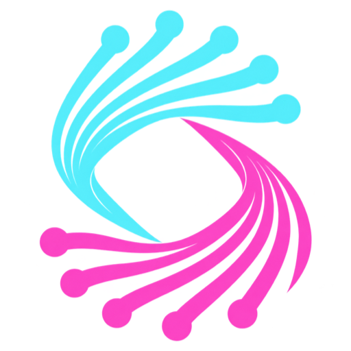

<p align="center">
  
</p>

<h1 align="center">GloveBox</h1>

<p align="center"><strong>Learn to glove: a webcam light-show trainer for LED glove flow.</strong></p>

Gloving is the rave flow art you do with LED gloves: one light on each
fingertip, ten in all, moved through finger rolls, waves, tracers, tutting
shapes and contours. Usually you perform a light show for a _receiver_, a
person sitting close with their eyes on your lights.

In GloveBox, **the webcam is the receiver**. The app shows you on camera and
draws a target circle for each of your ten fingertips. Those targets then move
through a move, and you follow them. GloveBox tracks your real fingertips,
lights each target up when you hit it, and scores how closely you followed.
Move up through the tiers as you get better.

> **Status: released for macOS.** Download it from the
> [latest release](https://github.com/BeardedUnicorn/GloveBox/releases/latest)
> (see [Install](#install)); after that it updates itself. The app isn't
> notarized yet, so macOS asks you to confirm the first time you open it. See
> the [roadmap](#roadmap) for what's next.

## Features

- **Two ways to track your fingertips:**
  - **Lit mode** practices in a lit room. On-device hand tracking
    ([MediaPipe Hand Landmarker](https://developers.google.com/edge/mediapipe/solutions/vision/hand_landmarker))
    finds all ten fingertips and knows which finger is which.
  - **Dark mode** practices the real way, in the dark with your gloves on.
    GloveBox finds the LEDs as bright points and follows each one.
    Calibrating once teaches it your gloves.
- **Ghost-trail targets:** ten glowing target rings, with a fading trail
  showing where each finger goes next.
- **Live feedback:** each ring lights up while your fingertip is on it. You
  also get a running accuracy score and a readout of whether you're ahead of
  or behind the beat. Tempo control slows a move down (0.5×) to learn it, or
  speeds it up.
- **Coaching:** tips for each move before you start, and cues on screen while
  it plays.
- **A move library in five tiers,** built from how glovers teach
  ([where each move comes from](docs/lessons/glove-tricks-review.md)):
  1. Foundations: finger waves, upward and downward finger rolls, splits,
     roll crawls.
  2. Flails & whips: wrist flails, the four flail patterns, the figure 8,
     whips.
  3. Tutting: King Tut boxes, grid slides, the box move, finger boxes,
     tracing.
  4. Tech & contours: clocking, point isolation, fixed 45s, the ball
     contour.
  5. Combos, up to a first full light show.
- **Progression:** grades, stars, tier unlocks, daily streaks, session
  history, and stats on which fingers are lagging.
- **Record mode:** perform a move on camera and save it as a lesson in your
  own library ("My Moves"). Lessons can be exported and shared as
  `.glovebox.json` files.
- **Two views:** practice in _performer_ view, which is mirrored like a
  mirror, or switch to _receiver_ view to see the show the way your receiver
  would.
- **Automatic updates** with release notes. The app tells you what each
  release since your version changed.

## Platforms

| Platform                        | Status                                                                 |
| ------------------------------- | ---------------------------------------------------------------------- |
| macOS (Apple silicon and Intel) | Released                                                               |
| Android, iOS                    | Planned (phase 2). The app is built with Tauri v2, which supports both |
| Windows, Linux                  | Not planned yet                                                        |

## Install

1. Download the DMG for your Mac from the
   [latest release](https://github.com/BeardedUnicorn/GloveBox/releases/latest):
   `macos-arm64` for Apple silicon, `macos-x64` for Intel.
2. Open it and drag GloveBox to Applications.
3. Open GloveBox. It isn't notarized yet, so macOS stops it the first time.
   Go to System Settings → Privacy & Security and click **Open Anyway**. On
   macOS 14 and earlier you can instead right-click the app and choose
   **Open**.
4. Allow camera access when macOS asks.

From then on GloveBox [updates itself](#desktop-updates). Until it's signed
with a Developer ID, macOS asks for camera access again after each update.

## Privacy

All camera processing happens **on your device**. No video, images or
tracking data leave your computer. The hand-tracking model and its runtime
ship inside the app, so GloveBox works offline. The MediaPipe library tries
to send usage metrics to Google by default. GloveBox's Content Security
Policy blocks that.

## Tech stack

- **[Tauri v2](https://v2.tauri.app/):** a small Rust shell, plus SQLite
  storage and the auto-updater.
- **React + TypeScript + Vite:** the whole app: tracking, lessons, scoring
  and UI.
- **MediaPipe Tasks Vision:** hand landmarks in Lit mode, running locally
  (WebAssembly and WebGL).
- **Custom LED-blob tracker** for Dark mode. It runs in a Web Worker:
  thresholding, connected components, then Hungarian matching of lights to
  fingers.
- **vitest, fast-check, `node --test` and `cargo llvm-cov`:** 100% unit test
  coverage, enforced in CI.

## Development

### Prerequisites

- [Rust](https://rustup.rs/). The version is pinned by `rust-toolchain.toml`.
- [Node.js](https://nodejs.org/) 24 (`.node-version`) and
  [pnpm](https://pnpm.io/).
- macOS: Xcode Command Line Tools.

### Commands

```bash
pnpm install
pnpm fetch-model        # downloads the hand-tracking model (sha256-checked)
pnpm tauri dev          # runs the app
pnpm test               # unit tests
pnpm test:coverage      # unit tests with the 100% coverage gate
```

With `pnpm tauri dev`, macOS asks for camera access on behalf of your
terminal app. To test the real permission prompt, build the app bundle with
`pnpm tauri build --debug --bundles app`.

### Change notes

Every change someone using GloveBox would notice adds a small file to
`changes/` in the branch that makes it. The file says how big the change is
(`bump: patch | minor | major`), which CHANGELOG heading it goes under
(`type: Added | Changed | Removed | Fixed | Security`), and one or more
bullets written for the person learning to glove.

[`changes/README.md`](changes/README.md) has the format. `pnpm release`
turns the notes into the next [CHANGELOG.md](CHANGELOG.md) section. The
update dialog and Settings → What's new show those words.

### Releasing

Releases are cut on `main` with nothing uncommitted:

```bash
pnpm release --dry-run   # the next version and its CHANGELOG section; changes nothing
pnpm release --publish   # bump, write the CHANGELOG, commit "Release X.Y.Z", tag vX.Y.Z, push
```

`pnpm release`:

1. Bumps the version by the highest note: `package.json`,
   `src-tauri/Cargo.toml` and `Cargo.lock`. `tauri.conf.json` reads its
   version from `package.json`.
2. Writes the CHANGELOG section and deletes the notes.
3. Commits "Release X.Y.Z" and tags `vX.Y.Z`.

Without `--publish`, nothing leaves your computer. `pnpm release publish`
pushes later. `--patch`, `--minor` or `--major` overrides the notes.

The version started at `0.0.0`, so the first release, 0.1.0, was
`pnpm release --minor --publish`.

The pushed tag starts the [Release workflow](.github/workflows/release.yml):

1. It checks that the tag is `package.json`'s version.
2. It builds the app for Apple silicon and for Intel (cross-compiled), each
   with its signed update.
3. It makes the GitHub release:
   - the version's CHANGELOG section as the release notes,
   - `GloveBox-X.Y.Z-macos-arm64.dmg` and `GloveBox-X.Y.Z-macos-x64.dmg`,
   - the updates (`.app.tar.gz` and `.sig`),
   - `latest.json`.

Pull requests that change the release files run the same builds without
publishing anything. `pnpm release --rebuild` builds this Mac's installer
into `releases/` locally.

The app is signed ad hoc unless these repository secrets are set:
`APPLE_CERTIFICATE`, `APPLE_CERTIFICATE_PASSWORD`, `APPLE_SIGNING_IDENTITY`,
`APPLE_ID`, `APPLE_PASSWORD` and `APPLE_TEAM_ID`. With them, the workflow
signs GloveBox with that Developer ID and notarizes it.

An ad hoc app has two drawbacks:

- macOS warns on first open (right-click → Open).
- macOS asks for camera access again after each update, because the
  signature changes.

### Desktop updates

The installed app updates itself from the latest GitHub release.

1. Ten seconds after launch, and then once a day, it reads
   `https://github.com/BeardedUnicorn/GloveBox/releases/latest/download/latest.json`.
   Settings → Updates checks now, or turns the automatic check off.
2. If that names a newer version, the app asks, showing what each release
   since yours changed. It never interrupts a practice session.
3. If you say yes, it downloads the update, checks its signature, replaces
   the app and restarts.

The Rust side does this with `tauri-plugin-updater`
(`src-tauri/src/updates.rs`, `src-tauri/src/platform/os.rs`). A development
build has no update feed: it says "Dev builds don't update".

Updates are signed with a minisign key:

- **The public key** is `plugins.updater.pubkey` in
  `src-tauri/tauri.conf.json`. **The private key and its password** are the
  repository secrets `TAURI_SIGNING_PRIVATE_KEY` and
  `TAURI_SIGNING_PRIVATE_KEY_PASSWORD`. Only the Release workflow's build
  step sees them, and a tag's build stops at once if the key isn't set.
- **Making the key (once):**
  1. Run `pnpm tauri signer generate -w ~/.tauri/glovebox-updater.key` and
     choose a password.
  2. Put the public key it prints (the contents of
     `~/.tauri/glovebox-updater.key.pub`) in place of
     `REPLACE_WITH_THE_UPDATER_PUBLIC_KEY` in `tauri.conf.json`.
  3. Set the secrets:
     - `gh secret set TAURI_SIGNING_PRIVATE_KEY < ~/.tauri/glovebox-updater.key`
     - `gh secret set TAURI_SIGNING_PRIVATE_KEY_PASSWORD` (it asks for the
       password)
- `pnpm release --rebuild` checks each update's signature against the
  public key before the update goes into `releases/`. So a mismatched key,
  or the placeholder, can't ship.
- `requireSignedVersion` is on. The app installs an update only when the
  version recorded in its signature is the one `latest.json` announces. An
  older signed build can't be passed off as a newer one.
- **Keep a copy of the private key and its password** away from this
  computer, in a password manager, say. Without them, no later release can
  update the installed apps.
- **A lost or leaked key:**
  1. Make a new one as above and replace both secrets and the public key.
  2. Release.
  3. Installed apps can't verify the new key's updates, so everyone has to
     download that release's DMG by hand once. Updates work again from then
     on.

## Roadmap

| Milestone | What it delivers                                                          | Status |
| --------- | ------------------------------------------------------------------------- | ------ |
| **M0**    | Scaffold, camera access, local hand tracking, CI with 100% coverage gates | Done   |
| **M0.5**  | Release pipeline (GitHub Actions), signed auto-updates with release notes | Done   |
| **M1**    | Core math: coordinates, lesson clock, smoothing, move generators, scoring | Done   |
| **M2**    | Lit-mode practice: targets, ghost trails, live hits, tempo, results       | Done   |
| **M3**    | Dark mode: LED-blob tracking and calibration                              | Done   |
| **M4**    | Saved history and progression: tiers, stars, streaks, stats               | Done   |
| **M5**    | Record mode, plus lesson import and export                                | Done   |
| **M6**    | First public macOS release (0.1.0), app icon, signed auto-updates         | Done   |
| **M6.5**  | Tuning on real gloves in a dark room; Developer ID signing, notarization  | Next   |
| **M7**    | Android and iOS                                                           | Later  |

## License

[MIT](LICENSE)
